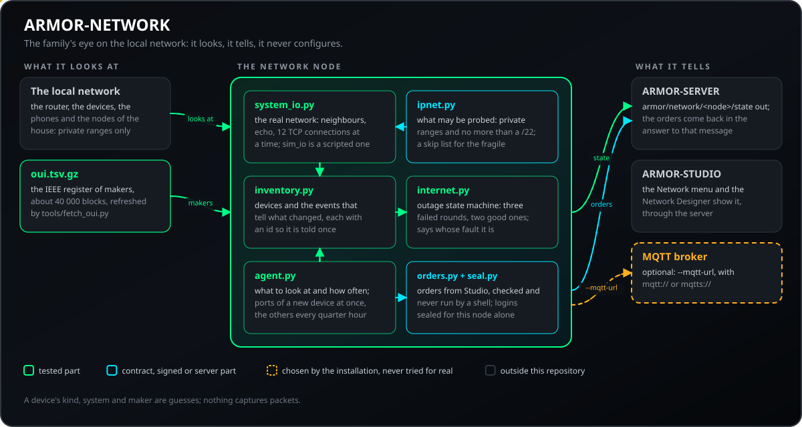
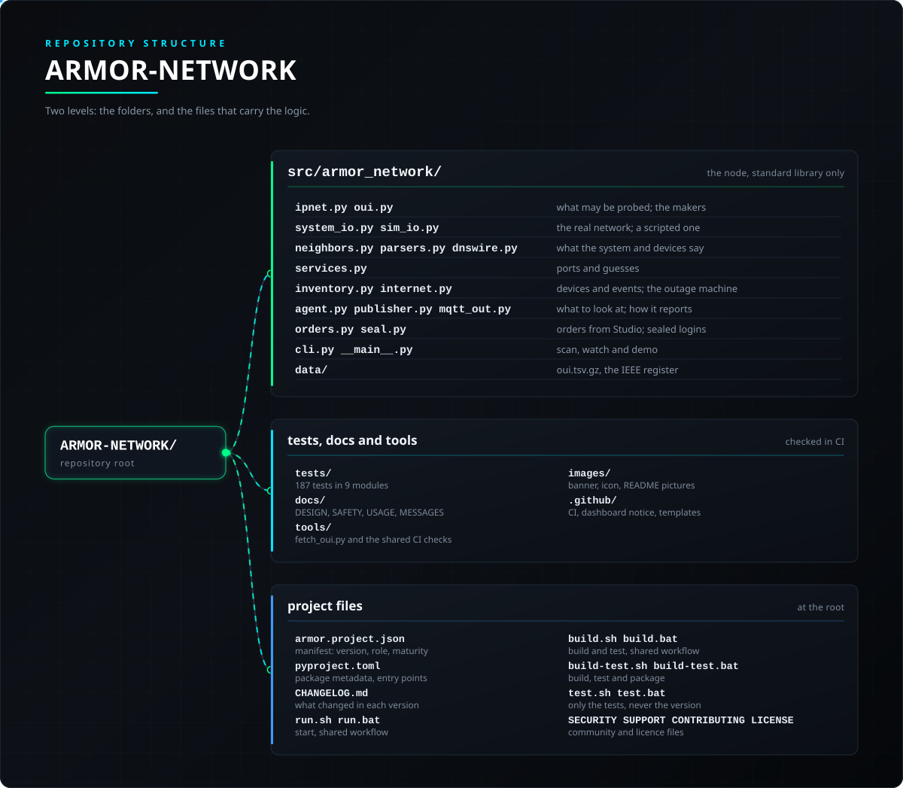

<p align="center">
  
</p>

# 🛰️ ARMOR-NETWORK

<p align="center">
  <a href="README.md">🇺🇸 English</a> |
  <a href="README_spa.md">🇪🇸 Español</a> |
  <a href="README_fra.md">🇫🇷 Français</a> |
  <a href="README_ita.md">🇮🇹 Italiano</a> |
  🇩🇪 <b>Deutsch</b> |
  <a href="README_zho.md">🇨🇳 简体中文</a> |
  <a href="README_jpn.md">🇯🇵 日本語</a> |
  <a href="README_por.md">🇵🇹 Português</a>
</p>

### Beobachtet das lokale Netz: die Geräte darin, ob das Internet da ist, was sich ändert und was neu ist (ein Python-Programm ohne Abhängigkeiten; es läuft auf einem Rechner des Netzes und meldet an ARMOR-SERVER)

<p align="center">
  
  
  
  
  
  
</p>

---

**Ehrlichkeitsprüfung - was heute läuft:** Der Scanner, das Inventar, das sagt, was sich geändert hat, die Internetprüfung, die Abfrage der öffentlichen Adresse, die Aufträge aus Studio und die versiegelten Logins werden auf einem Computer gegen ein geskriptetes Netz getestet (187 Tests; jede Nachricht wird vom Vertrag von ARMOR-COMMON akzeptiert), und das Programm läuft als Dienst am CM5-Testaufbau und beobachtet das echte Netz, in dem der Aufbau steht (ein Router, die Telefone und Knoten des Hauses). Es hat noch kein ganzes Haus wochenlang beobachtet, es fragt nur den Router und konfiguriert ihn nie, und was ein Gerät ist (Art, System, Hersteller), ist eine Vermutung. Es fängt keine Pakete ab: Es sieht nicht, wer mit wem spricht, und Verkehr pro Gerät und Einbruchserkennung im strengen Sinn brauchen die Zähler des Routers oder einen Mirror-Port, was ein späterer Schritt ist.

---

## 📋 Auf einen Blick

| | |
|---|---|
| Version | `0.1.6` |
| Reifegrad | Etabliert |
| Rolle | Knoten für das lokale Netz: was im Netz ist, was sich änderte, das Internet, Aufträge aus Studio |
| Technik | Python 3.11+, nur Standardbibliothek |
| Tests | 187 (`python -m unittest discover -s tests`) |
| Vertrag | Nachricht `armor/network/<Knoten>/state`, 111 Konformitätsvektoren (Nachrichten und Aufträge) |
| Läuft auf | Ein Rechner des überwachten Netzes (Linux, Windows oder macOS); der CM5-Prüfstand als Dienst |
| Auf echter Hardware | Läuft als Dienst am CM5-Testaufbau und beobachtet sein echtes Netz (einen Router, die Telefone und Knoten des Hauses) |
| Lizenz | GPL-3.0-or-later |

**Springe zu:** [Überblick](#-überblick) · [Architektur](#-architektur) · [Sicherheit](#-sicherheit-und-schutz) · [Schnittstellen](#-schnittstellen) · [Konfiguration](#-konfiguration) · [Schnellstart](#-schnellstart) · [Tests](#-tests) · [Probleme](#-fehlerbehebung) · [Struktur](#-struktur-des-repositorys) · [Verwandte](#-verwandte-projekte)

## 🚦 Projektstatus

Jede Zeile ist ein Teil dieses Repositorys, und die Ampel sagt, wie weit er heute ist. Sie beruht auf dem, was das Repository zeigen kann (Tests, Builds, Läufe), nicht auf dem, was geplant ist.

🟢 Fertig und überprüft · 🟡 Funktioniert, mit bekannten Grenzen · 🟠 Teilweise fertig oder noch nicht überprüft · 🔴 Nicht gemacht oder funktioniert nicht

| Bereich | Stand | Was das hier bedeutet |
|---|---|---|
| Software | 🟢 | Der Scanner, das Inventar, das sagt, was sich geändert hat, die Internetprüfung, die Abfrage der öffentlichen Adresse und die Befehle von Studio laufen als Dienst auf dem CM5-Prüfstand. |
| Tests | 🟢 | 187 Tests bestehen gegen ein geskriptetes Netz, und jede Nachricht wird vom Vertrag von ARMOR-COMMON akzeptiert. |
| Protokolle und Daten | 🟡 | Was ein Gerät ist (Art, System, Hersteller), ist eine Vermutung, und nichts fängt Pakete ab: Verkehr pro Gerät und Einbruchserkennung im strengen Sinn gibt es nicht. |
| Hardware | 🟡 | Er überwacht das echte Netz des CM5-Prüfstands (ein Router, die Telefone und Knoten des Hauses), hat aber noch nie wochenlang ein ganzes Haus überwacht. |
| Sicherheit | 🟡 | Er fragt den Router nur ab und konfiguriert ihn nie; die versiegelten Zugangsdaten sind auf dem Host getestet, und es gab keine unabhängige Prüfung. |
| Integration | 🟡 | Seine Nachrichten erreichen den Server des CM5-Prüfstands und Studio; die Befehle von Studio sind gegen ein geskriptetes Netz getestet. |
| Dokumentation | 🟢 | Acht Sprachen und das Änderungsprotokoll sind aktuell. |

## 🎯 Überblick

* **Was im Netzwerk ist:** die Nachbartabelle des Rechners, ein Anstupsen jeder Adresse, damit sie sich füllt, ein Echo an jedes gefundene Gerät (Latenz und TTL) und was Geräte über sich selbst ankündigen (mDNS, UPnP, NetBIOS, Reverse-DNS). Je Gerät: Adresse, MAC, Hersteller (aus dem IEEE-Register mit 40.000 Blöcken), Name, Art, System, offene Ports mit dem, was jeder sagt, und wann es zuerst und zuletzt gesehen wurde.
* **Ports:** eine TCP-Verbindung zu 17 (oder 44) Ports je Gerät, zwölf gleichzeitig, mit höchstens einigen hundert gelesenen Bytes der Antwort; nie ein Login, nie ein Exploit. Ein neues Gerät wird sofort angesehen, die anderen alle Viertelstunde.
* **Was sich ändert:** ein Gerät, das auftaucht (die ersten drei Scans lernen nur), verstummt oder zurückkommt, seine Adresse ändert, ein Port, der sich öffnet oder schließt, und zwei Rechner, die für eine Adresse antworten (vor allem die des Routers). Jedes Ereignis hat eine ID und wird daher nur einmal gemeldet.
* **Das Internet:** alle paar Sekunden ein Echo an den Router, eine TCP-Verbindung, zwei DNS-Fragen an gewählte Resolver und eine Webseite. Ein Ausfall braucht drei Runden, um so zu heißen, und zwei, um beendet zu sein, wird ab der ersten fehlgeschlagenen Runde datiert und bis zur ersten guten gezählt und sagt, wessen Schuld es ist: die des Anbieters (der Router antwortet, dahinter nichts) oder die dieser Seite (auch der Router antwortet nicht). Latenz, Verlust und die Ausfälle der letzten 24 Stunden.
* **Es sieht nur Ihr eigenes Netzwerk:** es verweigert jede nicht private Adresse (10/8, 172.16/12, 192.168/16) und jeden Bereich über /22; eine Ausschlussliste hält es von Empfindlichem fern; an ein Gerät wird nichts gesendet, was keine Frage ist.
* **Die Nachricht** `armor/network/<Knoten>/state`: die Schnittstelle, das Internet, jedes Gerät und die letzten Ereignisse; sie steht im gemeinsamen Vertrag (111 Vektoren) und trägt Befunde, nie Befehle. `python -m armor_network scan` druckt sie als Tabelle, `watch` meldet an ARMOR-SERVER, `demo` spielt ein erfundenes Haus (ein neues Gerät kommt hinzu, eine Kamera öffnet Telnet, das Internet fällt aus und kommt zurück, jemand antwortet für den Router) ohne ein Netzwerk zu berühren.
* **Wo man es sieht:** das Netzwerk-Menü von ARMOR-STUDIO (die Geräte, das Internet mit Ausfällen und Latenz, der Datenverkehr und die Ereignisse; ein Administrator benennt Geräte und markiert bekannte, was den Alarm eines neuen Geräts beruhigt), der Netzwerkplaner (die Zeichnung des Hausnetzwerks, verglichen mit dem Gefundenen und fähig, es zu zeichnen) und der Netzwerk-Bildschirm der Android-App. ARMOR-SERVER löst die Alarme aus.
* **Aufträge aus Studio:** sofort ein Scan, ein Ping, ein Traceroute, ein Aufwecken, die Ports oder die Webseite eines Geräts und eine Prüfung mit einem von Ihnen gegebenen Login; Aufträge kommen in der Antwort auf die eigene Nachricht des Knotens an (nie als Verbindung zum Knoten), jeder wird geprüft, bevor etwas geschieht, und nichts läuft über eine Shell.
* **Logins, die sicher bleiben:** der Login einer Prüfung reist nur für diesen Knoten versiegelt, wird nur per Digest oder HTTPS gesendet (nie Basic über Klartext-HTTP), nur an das Gerät, dessen HTTPS-Zertifikat beim ersten Mal gesehen wurde, und nie zurückgespiegelt.
* **Die öffentliche Seite:** die öffentliche Adresse des Hauses, wer sie liefert und wo sie liegt (alle paar Minuten eine HTTPS-Anfrage an einen festen öffentlichen Dienst; `--no-public-info` schaltet sie ab). Mit `--dns-name` löst er außerdem den Namen auf, unter dem das Haus von außen erreichbar ist, und meldet, ob er auf diese Adresse zeigt.
* **Ein Dienst:** er läuft als systemd-Einheit am CM5-Testaufbau (von Hand geschrieben, siehe die Anleitung) und hält seine Daten in einem eigenen Ordner.
* **Noch nicht:** die Zähler des Routers selbst (Verkehr je Gerät), Paketmitschnitt, irgendetwas steuern (ein Gerät sperren, einen Port schließen, den Router ändern) und Wochen in einem echten Netzwerk.

## 🧩 Rolle in A.R.M.O.R.

ARMOR-NETWORK ist das Auge der Familie auf das lokale Netz. Es läuft auf einem Rechner des Netzes (der CM5 am Aufbau), sieht an, was da ist, ohne es zu berühren, und meldet an [ARMOR-SERVER](https://github.com/JuanenRac/ARMOR-SERVER), der Namen, versteckte und beobachtete Geräte und Ausfälle führt; das Menü *Netzwerk* und der *Netzwerk-Designer* von [ARMOR-STUDIO](https://github.com/JuanenRac/ARMOR-STUDIO) sowie der Netzwerk-Bildschirm von [ARMOR-ANDROID-CONTROL](https://github.com/JuanenRac/ARMOR-ANDROID-CONTROL) zeigen es, und Studio kann ihm Aufträge geben. Es konfiguriert nie den Router oder ein Gerät.

| Er spricht mit | Wie | Wozu |
|---|---|---|
| ARMOR-SERVER | HTTP-`POST` mit dem Ingest-Token (`--server-url`) | der Zustand geht hinein; die Aufträge kommen in der Antwort zurück |
| MQTT | `--mqtt-url` (`mqtt://` oder `mqtts://`) | dieselbe Nachricht auch am Broker; die manuellen Aufträge reisen nicht so |
| ARMOR-STUDIO | über den Server | das Netzwerk-Menü und der Netzwerk-Designer zeigen es und geben Aufträge |
| ARMOR-ANDROID-CONTROL | über den Server | der Netzwerk-Bildschirm |
| ARMOR-COMMON | der Vertrag der Nachricht und der Aufträge | `--validate` prüft jede Nachricht damit |

## 🏛️ Architektur

<p align="center">
  
</p>

## 🔒 Sicherheit und Schutz

| Bedrohung | Abwehr |
|---|---|
| Scannen außerhalb des Hauses oder fremder Netze | Nur private Bereiche (10.0.0.0/8, 172.16.0.0/12, 192.168.0.0/16) und nie mehr als 1024 Adressen (ein /22); `--cidr` ist immer privat; die Sperre ist `check_scan_range`, keine Option |
| Etwas Empfindliches stören | Eine Ausschlussliste (`--skip IP`, wiederholbar); an ein Gerät wird nichts gesendet, was keine Frage ist; nie ein Login, nie ein Exploit; 12 Verbindungen gleichzeitig, die wenige hundert Bytes lesen |
| Riskante offene Ports bleiben unbemerkt | Sie werden markiert: 21, 23, 3389, 5900, 6379, 3306, 5432, 7547 und 445 |
| Aufträge vom Server, die Befehle einschleusen | Eine geschlossene Liste: `scan_now`, `ping`, `traceroute`, `wake`, `ports`, `http`, `inspect`; höchstens 4 gleichzeitig; eine Auftrags-ID aus Buchstaben, Ziffern, `_` und `-` (höchstens 32); Ausgabe bei 2000 gekappt; MAC geprüft; nichts läuft über eine Shell; Aufträge kommen in der Antwort auf die eigene Nachricht des Knotens, nie als Verbindung zum Knoten |
| Das Login einer Inspektion gelangt nach außen | Es reist nur für diesen Knoten versiegelt, nur über Digest oder HTTPS (nie Basic über einfaches HTTP), nur zum Gerät, dessen HTTPS-Zertifikat beim ersten Mal gesehen wurde, und wird nie in einer Antwort wiederholt; die Werkslogins, die es probiert, stammen aus einer festen Liste |
| Eine Anfrage, die das Haus verlässt | Eine HTTPS-Anfrage an einen festen öffentlichen Dienst (standardmäßig `https://ipinfo.io/json`) alle paar Minuten für die öffentliche Adresse; `--no-public-info` schaltet sie ab; `--dns-name` prüft zusätzlich, dass der Name, unter dem das Haus erreichbar ist, darauf zeigt |

**Was es nie tut:** den Router konfigurieren, Pakete mitschneiden, ein Gerät sperren oder einen Port schließen. Was ein Gerät ist (Art, System, Hersteller), ist eine Vermutung. Die Sicherheitshinweise stehen in [docs/SAFETY.md](docs/SAFETY.md); eine unabhängige Prüfung gab es nicht.

## 🔌 Schnittstellen

| Route | Authentifizierung | Was sie tut |
|---|---|---|
| `armor/network/<node>/state` | Nachricht | die Schnittstelle, das Internet, jedes Gerät und die letzten Ereignisse; sie trägt Befunde, nie Befehle |
| `python -m armor_network scan [--json]` | - | das Netz einmal ansehen und als Tabelle (oder Nachricht) ausgeben |
| `python -m armor_network watch` | - | weiter beobachten; mit `--server-url` und `--ingest-token` meldet es an ARMOR-SERVER, mit `--mqtt-url` auch an den Broker |
| `python -m armor_network demo [--count N]` | - | ein erfundenes Haus (ein Gerät tritt bei, eine Kamera öffnet Telnet, das Internet fällt aus): kein Netz wird berührt |
| `python -m armor_network internet`  `oui <mac>` | - | eine Runde der Internetprüfung; wer eine Netzwerkkarte gebaut hat |

Die Aufträge aus Studio (`scan_now`, `ping`, `traceroute`, `wake`, `ports`, `http`, `inspect`) reiht der Server über die Routen `/api/v1/network/...` von ARMOR-SERVER ein; sie erreichen den Knoten in der Antwort auf seine Nachricht; der Vertrag der Nachricht und der Aufträge liegt in ARMOR-COMMON (111 Konformitätsvektoren). Siehe [docs/MESSAGES.md](docs/MESSAGES.md) und [docs/USAGE.md](docs/USAGE.md).

## ⚙️ Konfiguration

| Einstellung | Standard | Was sie tut |
|---|---|---|
| `--node-id` | network-1 | der Name dieses Knotens in den Nachrichten (Kleinbuchstaben, Ziffern, `-` und `_`) |
| `--profile {quick,standard}` | quick | 17 oder 44 Ports je Gerät; ein neues Gerät wird sofort angesehen, die anderen alle Viertelstunde |
| `--no-ports`  `--skip IP`  `--cidr` | - | keine Ports; eine nie zu prüfende Adresse; das zu scannende Netz (privat, höchstens 1024 Adressen) |
| `--scan-every`  `--internet-every` | 60 s  5 s | Sekunden zwischen Durchläufen und Internetprüfungen |
| `--server-url`  `--ingest-token`  `--mqtt-url`  `--mqtt-user` | - | wohin gemeldet wird; das Token dieses Knotens (Studio zeigt es) oder das gemeinsame Ingest-Token, nie in eine Datei geschrieben |
| `--data-dir` | armor-network-data | wo Inventar und Ausfälle zwischen Läufen liegen |
| `--validate`  `--no-public-info`  `--public-info-url`  `--dns-name` | - | jede Nachricht gegen ARMOR-COMMON prüfen; die Abfrage der öffentlichen Adresse (abschalten, ihre Adresse, der zu prüfende Name) |

Alles wird mit Kommandozeilenoptionen gesetzt (siehe [docs/USAGE.md](docs/USAGE.md), das auch die systemd-Einheit zeigt, die es am Laufen hält). Ein Ausfall wird nach drei fehlgeschlagenen Runden festgestellt und nach zwei guten beendet; die ersten drei Durchläufe lernen nur, was da ist.

## 🚀 Schnellstart

**Voraussetzungen:** Python 3.11+ (nur Standardbibliothek) und ein Rechner im zu überwachenden Netz (Linux, Windows oder macOS).

```powershell
python -m unittest discover -s tests                                                 # 187 Tests: Parser mit echten Proben, die Sperre dessen, was geprüft werden darf, das Inventar, das Internet, der ganze Agent gegen ein geskriptetes Haus
python -m armor_network scan                                                         # das Netz einmal ansehen und ausgeben (nur das private Netz dieses Rechners)
python -m armor_network watch --server-url http://127.0.0.1:8080 --ingest-token ...  # weiter beobachten und ARMOR-SERVER melden
python -m armor_network demo --count 3                                               # ein erfundenes Haus: kein Netz wird berührt
python tools/fetch_oui.py                                                            # die Herstellertabelle aus dem IEEE-Register erneuern (von Hand, ab und zu)
```

Siehe die [Benutzung](docs/USAGE.md) und den [Entwurf](docs/DESIGN.md).

## 🧪 Tests

```powershell
python -m unittest discover -s tests  # 187 Tests
python -I tools/armor_ci_validate.py
```

| Testdatei | Tests | Was sie abdeckt |
|---|---|---|
| `test_network.py` | 56 | die Parser mit echten Proben, die Sperre dessen, was geprüft werden darf, das Inventar, das Internet und der Agent gegen ein geskriptetes Haus |
| `test_system_io_layer.py`  `test_system_io.py` | 39 | die Schicht des echten Netzes: Nachbarn, Echos, TCP, DNS |
| `test_orders.py`  `test_orders_edges.py` | 56 | die Aufträge aus Studio und ihre Grenzen |
| `test_cli_commands.py` | 20 | die Kommandozeile |
| `test_mqtt_out.py`  `test_seal.py` | 10 | die MQTT-Ausgabe und die versiegelten Logins |
| `test_typing_behaviour.py` | 6 | das Verhalten, das die Typannotationen beibehalten: die Scan-Schranke, der Auftragsparser und die Herstellertabellen |

GitHub Actions führt bei jedem Push und Pull Request die A.R.M.O.R.-Basis aus: die Prüfung von Manifest, Version, Änderungsprotokoll und README-Parität, dann den eigenen Build und die eigenen Tests des Projekts. Die Quellen bestehen auch die Typprüfung: `python -m mypy` (in `pyproject.toml` konfiguriert) meldet nichts, und `test_typing_behaviour.py` hält das Verhalten fest, das die Annotationen beibehalten.

## 🏗️ Build und Veröffentlichung

Es ist reines Python: Es gibt nichts zu kompilieren. Die Version steht in `pyproject.toml`, in `armor.project.json` und im README-Badge (aus dem Manifest gelesen); jede Version hat ihren Eintrag in [CHANGELOG.md](CHANGELOG.md). Releases werden auf GitHub veröffentlicht.

## 🩺 Fehlerbehebung

| Du siehst | Weil | Tu |
|---|---|---|
| `... is not a private network` oder `... has N addresses; at most 1024` | `--cidr` nennt einen öffentlichen Bereich oder einen größer als /22 | einen privaten Bereich mit höchstens 1024 Adressen nehmen |
| Wenige oder keine Geräte gefunden | die Nachbartabelle des Systems füllt sich durch Anstoßen jeder Adresse, was die Erlaubnis zum Pingen oder Lesen braucht | mit den Rechten eines Benutzers ausführen, der pingen und die Nachbartabelle lesen darf |
| Ein empfindliches Gerät verhält sich beim Scannen schlecht | es mag die Port-Versuche nicht | `--skip <Adresse>` (wiederholbar) oder `--no-ports` ergänzen |
| Studio erhält nie eine Nachricht | der Server ist nicht erreichbar oder lehnt das Token ab (das Problem wird wie jedes andere gezählt: `unreachable`, `unauthorized`) | `--server-url` und das Token prüfen (das dieses Knotens, das Studio zeigt, oder das gemeinsame Ingest-Token) |

## 📂 Struktur des Repositorys

<p align="center">
  
</p>

<details>
<summary>Textversion des Baums</summary>

```text
ARMOR-NETWORK/
├── src/armor_network/
│   ├── ipnet.py oui.py                      was geprüft werden darf; die Hersteller
│   ├── system_io.py sim_io.py               das echte Netz; ein geskriptetes
│   ├── neighbors.py parsers.py dnswire.py   was System und Geräte sagen
│   ├── services.py                          Ports und Vermutungen
│   ├── inventory.py internet.py             Geräte und Ereignisse; die Ausfallmaschine
│   ├── agent.py publisher.py mqtt_out.py    was zu beobachten ist; wie berichtet wird
│   ├── orders.py seal.py                    Aufträge aus Studio; versiegelte Logins
│   ├── cli.py __main__.py                   scan, watch und demo
│   └── data/                                oui.tsv.gz, das IEEE-Register
├── tests/                                   187 Tests in 9 Modulen
├── docs/                                    DESIGN, SAFETY, USAGE, MESSAGES
├── tools/                                   fetch_oui.py erneuert das Herstellerregister; die gemeinsamen CI-Prüfungen und der Starter
├── images/                                  Banner, Symbol und die Bilder des READMEs
├── .github/                                 CI-Workflow, Dashboard-Hinweis, Vorlagen für Issues und Pull Requests
├── armor.project.json                       Manifest: Version, Rolle, Reife
├── pyproject.toml                           Paket-Metadaten, Einstiege
├── CHANGELOG.md                             was sich in jeder Version geändert hat
├── run.sh run.bat                           Start, gemeinsamer Ablauf
├── build.sh build.bat                       Bauen und Testen, gemeinsamer Ablauf
├── build-test.sh build-test.bat             Bauen, Testen und Verpacken
├── test.sh test.bat                         nur die Tests, nie die Version
└── SECURITY.md SUPPORT.md CONTRIBUTING.md CODE_OF_CONDUCT.md LICENSE
```

</details>

## 🗺️ Roadmap und bekannte Grenzen

**Bekannte Grenzen heute**

* Es hat noch nie ein ganzes Haus über Wochen überwacht.
* Es fragt nur den Router und konfiguriert ihn nie; was ein Gerät ist (Art, System, Hersteller), ist eine Vermutung.
* Es zeichnet keine Pakete auf und sieht daher nicht, wer mit wem spricht; Verkehr je Gerät und Einbruchserkennung im strengen Sinn brauchen die Zähler des Routers oder einen Spiegelport.
* Keine unabhängige Sicherheitsprüfung.

**Als Nächstes**

* Die eigenen Zähler des Routers (Verkehr je Gerät), Paketmitschnitt und Wochen in einem echten Netz.
* Etwas zu steuern (ein Gerät sperren, einen Port schließen, den Router ändern) ist ohne dokumentierte Risikoprüfung nicht geplant.

## 🌍 Sprachen

README und Texte gibt es auf Englisch, Spanisch, Französisch, Italienisch, Deutsch, Chinesisch, Japanisch und europäischem Portugiesisch.

## 🔗 Verwandte Projekte

**A.R.M.O.R.** (Autonomous Radar & Multimodal Observation Range) ist ein Perimeter-Sicherheitssystem aus unabhängigen Repositorys. Jedes hat eine eigene Version, eigene Tests und ein eigenes README; hier ist die Familie:

* **[ARMOR-COMMON](https://github.com/JuanenRac/ARMOR-COMMON)** - Nachrichtenverträge, Validierer, Konformitätsvektoren und generierte Typen
* **[ARMOR-NODE-RADAR](https://github.com/JuanenRac/ARMOR-NODE-RADAR)** - Feldknoten-Firmware für ESP32-S3 mit drei Radaren und eigenem Web-Panel
* **[ARMOR-NODE-SOLAR](https://github.com/JuanenRac/ARMOR-NODE-SOLAR)** - Protokolle für Solar-Wechselrichter und -Batterien und die Nachrichten eines Gateway-Knotens
* **[ARMOR-NODE-ELECTRICAL](https://github.com/JuanenRac/ARMOR-NODE-ELECTRICAL)** - Elektroknoten: Zähler, die Nachricht der Netzmesswerte und die Regeln fürs Schalten
* **[ARMOR-NODE-ALARM](https://github.com/JuanenRac/ARMOR-NODE-ALARM)** - Alarmknoten und Alarmzentrale: Zonen, Scharfschalten, Verzögerungen, Sirene und PIN, mit dem Server oder ohne ihn
* **[ARMOR-NODE-HMI](https://github.com/JuanenRac/ARMOR-NODE-HMI)** - Touch-Panel: der Systemzustand auf einem Wandbildschirm, Scharf- und Quittieren sowie das Zuhause des Sprachassistenten
* **ARMOR-NETWORK** (dieses Repository) - Das lokale Netzwerk: seine Geräte, das Internet und was sich ändert
* **[ARMOR-SERVER](https://github.com/JuanenRac/ARMOR-SERVER)** - Zentraler Koordinator: Telemetrie, Alarme, Geräte, Solarmesswerte und Kameras
* **[ARMOR-STUDIO](https://github.com/JuanenRac/ARMOR-STUDIO)** - Web-Konsole: Kameras, Radar, Alarme, Solarenergie und 2D/3D-Standortdesigner
* **[ARMOR-ANDROID-CONTROL](https://github.com/JuanenRac/ARMOR-ANDROID-CONTROL)** - Android-Bedienclient mit Live-Radar in 2D/3D
* **[ARMOR-IOS-CONTROL](https://github.com/JuanenRac/ARMOR-IOS-CONTROL)** - iPhone-Bedienclient
* **[ARMOR-SERVER-AI](https://github.com/JuanenRac/ARMOR-SERVER-AI)** - Visuelle Inferenzrichtlinie, die ihre Entscheidungen erklärt und nie handelt
* **[ARMOR-VISION](https://github.com/JuanenRac/ARMOR-VISION)** - Kamerazonen, Masken und Erkennungsregeln für den Jetson Orin NX
* **[ARMOR-VOICE-AI](https://github.com/JuanenRac/ARMOR-VOICE-AI)** - Offline-Sprachabsichten mit einer nicht fälschbaren Bestätigung
* **[ARMOR-HARDWARE](https://github.com/JuanenRac/ARMOR-HARDWARE)** - Gehäuse, Elektronik und die Abnahmematrix am Prüfstand
* **[ARMOR-DEVOPS](https://github.com/JuanenRac/ARMOR-DEVOPS)** - Bereitstellung, CM5-Prüfstand, Backup und TLS
* **[ARMOR-SIMULATOR](https://github.com/JuanenRac/ARMOR-SIMULATOR)** - Offline-Telemetriesimulator mit wiederholbaren Fehlern
* **[ARMOR-UPDATER](https://github.com/JuanenRac/ARMOR-UPDATER)** - Erkennt, installiert und aktualisiert die eigenen Repositorys des Ökosystems
* **[ARMOR-DOCS](https://github.com/JuanenRac/ARMOR-DOCS)** - Architektur, Sicherheitsgrundlage und die Fähigkeitsmatrix

## 📚 Dokumentation

* [Entwurf](docs/DESIGN.md): wie der Knoten beobachtet, sich erinnert und entscheidet
* [Sicherheit](docs/SAFETY.md): was es berühren darf und was nie
* [Benutzung](docs/USAGE.md): die Befehle, die Optionen und die systemd-Einheit
* [Nachrichten](docs/MESSAGES.md): die Nachricht des Knotens und seine Aufträge
* [Fähigkeitsmatrix: was belegt ist und was nicht](https://github.com/JuanenRac/ARMOR-DOCS/blob/main/docs/CAPABILITY_MATRIX.md)
* [Projektkatalog: Versionen und wie die Repositorys voneinander abhängen](https://github.com/JuanenRac/ARMOR-DOCS/blob/main/docs/PROJECT_CATALOG.md)
* [Änderungsverlauf dieses Repositorys](CHANGELOG.md)

## 🤝 Mitwirken und Community

* Führe vor einem Pull Request `python -I tools/armor_ci_validate.py` und die Tests aus: Beide müssen bestehen. Siehe [CONTRIBUTING.md](CONTRIBUTING.md) und den [Verhaltenskodex](CODE_OF_CONDUCT.md).
* Das README gibt es in acht Sprachen, und es wird aus den Quellen in ARMOR-DOCS erzeugt: Eine Textänderung erfolgt dort.
* Eine Änderung an einer Nachricht zwischen Komponenten beginnt in ARMOR-COMMON.
* Beschreibe nichts als auf einer Platine funktionierend, was nur gebaut wurde.
* Melde eine Schwachstelle privat: [SECURITY.md](SECURITY.md). Fragen, Ideen und Meldungen: electrohobby3d@gmail.com ([SUPPORT.md](SUPPORT.md)).

## 👤 AUTOR

**JuanenRac (Electro Hobby 3D)** · electrohobby3d@gmail.com

## 📜 LIZENZ

GPL-3.0-or-later - siehe [LICENSE](LICENSE).
