<p align="center">
  
</p>

# 🛰️ ARMOR-NETWORK

<p align="center">
  <a href="README.md">🇺🇸 English</a> |
  <a href="README_spa.md">🇪🇸 Español</a> |
  <a href="README_fra.md">🇫🇷 Français</a> |
  <a href="README_ita.md">🇮🇹 Italiano</a> |
  <a href="README_deu.md">🇩🇪 Deutsch</a> |
  🇨🇳 <b>简体中文</b> |
  <a href="README_jpn.md">🇯🇵 日本語</a> |
  <a href="README_por.md">🇵🇹 Português</a>
</p>

### 监视本地网络：上面有哪些设备、互联网是否可用、哪些发生了变化、哪些是新的（无依赖的 Python 程序；在网络中的一台机器上运行并向 ARMOR-SERVER 报告）

<p align="center">
  
  
  
  
  
  
</p>

---

**诚实性检查 - 今天真正能运行的部分:** 扫描器、说明发生了什么变化的清单、互联网检查、公网地址查询、来自 Studio 的指令和加密封装的登录信息，都在计算机上对照脚本化网络测试（181 个测试；每条消息都被 ARMOR-COMMON 的契约接受），程序在 CM5 测试台上作为服务运行，监视测试台所在的真实网络（一台路由器、住宅的手机和节点）。它还没有连续数周监视整个住宅，只询问路由器而从不配置它，设备是什么（类型、系统、厂商）只是猜测。它不抓包：看不到谁与谁通信，每个设备的流量和严格意义上的入侵检测需要路由器的计数器或镜像端口，那是以后的一步。

---

## 📋 速览

| | |
|---|---|
| 版本 | `0.1.3` |
| 成熟度 | 成熟 |
| 测试 | 181 (`python -m unittest discover -s tests`) |
| 技术栈 | Python 3.11+ (standard library only) |
| 真实硬件 | 在 CM5 测试台上作为服务运行，监视其真实网络（路由器、住宅的手机和节点） |

## 🎯 概述

* **网络上有什么：** 本机的邻居表、为填充它而对每个地址的试探、对每个发现的设备的回显（延迟与 TTL），以及设备对自身的宣告（mDNS、UPnP、NetBIOS、反向 DNS）。每台设备：地址、MAC、厂商（来自 IEEE 的 40,000 个块的登记表）、名称、类型、系统、开放端口及各自的应答内容，以及首次和最近一次看到的时间。
* **端口：** 对每台设备的 17（或 44）个端口进行 TCP 连接，每次十二个，最多只读取应答的几百字节；从不登录，从不利用漏洞。新设备立即检查，其余每刻钟一次。
* **变化：** 设备出现（前三次扫描只学习）、沉默或恢复、更改地址、端口打开或关闭，以及两台机器响应同一个地址（尤其是路由器的地址）。每个事件都有 id，因此只通报一次。
* **互联网：** 每隔几秒对路由器回显、一次 TCP 连接、向选定解析器发出两个 DNS 问题以及一个网页。三轮才算中断、两轮才算结束，从第一轮失败起算、数到第一轮成功，并指出是谁的问题：运营商一侧（路由器有响应而其后没有）还是本地一侧（路由器也没有响应）。延迟、丢包和最近 24 小时的中断。
* **只查看您自己的网络：** 拒绝任何非私有地址（10/8、172.16/12、192.168/16 之外）和大于 /22 的范围；排除列表让它远离脆弱的设备；不会向设备发送任何不是提问的内容。
* **消息** `armor/network/<节点>/state`：接口、互联网、每台设备和最新事件；它在共享契约中（330 个向量），只携带发现，绝不携带命令。`python -m armor_network scan` 以表格打印，`watch` 通知 ARMOR-SERVER，`demo` 演示一栋虚构的房子（新设备加入、摄像头打开 Telnet、互联网中断又恢复、有人冒充路由器应答），不触碰任何网络。
* **在哪里显示：** ARMOR-STUDIO 的网络菜单（设备、带中断和延迟的互联网、流量和事件；管理员为设备命名并标记已知设备，这会平息新设备的警报）、网络设计器（家中网络的图纸，与发现的内容对比并能自动绘制）以及 Android 应用的网络界面。警报由 ARMOR-SERVER 发出。
* **来自 Studio 的指令：**立即扫描、ping、traceroute、网络唤醒、某个设备的端口或网页，以及用你提供的登录信息进行检查；指令在对节点自身消息的应答中到达（绝不是向节点发起连接），每条在执行前都要检查，也不通过 shell 运行任何东西。
* **始终安全的登录信息：**检查所用的登录信息仅为该节点加密封装后传输，只通过 Digest 或 HTTPS 发送（绝不通过明文 HTTP 的 Basic），只发给首次见到其 HTTPS 证书的设备，并且从不回显。
* **公网一侧：**住宅的公网地址、提供者及其位置（每隔几分钟向一个固定的公共服务发一次 HTTPS 请求；`--no-public-info` 可关闭）。使用 `--dns-name` 时，还会解析从外部访问住宅所用的域名，并说明它是否指向该地址。
* **一项服务：**它作为 systemd 单元在 CM5 测试台上运行（手写，见使用指南），数据保存在自己的文件夹中。
* **尚未：** 路由器自身的计数器（按设备统计流量）、抓包、控制任何东西（封锁设备、关闭端口、修改路由器）以及在真实网络上运行数周。

## 🧩 在 A.R.M.O.R. 中的角色

ARMOR-NETWORK 是家族观察本地网络的眼睛。它运行在网络中的一台机器上（测试台上的 CM5），只看不碰，并向 [ARMOR-SERVER](https://github.com/JuanenRac/ARMOR-SERVER) 报告，由后者保存名称、隐藏和监视的设备以及中断记录；[ARMOR-STUDIO](https://github.com/JuanenRac/ARMOR-STUDIO) 的*网络*菜单和*网络设计器*以及 [ARMOR-ANDROID-CONTROL](https://github.com/JuanenRac/ARMOR-ANDROID-CONTROL) 的网络界面显示这些内容，Studio 还可以给它下达指令。它从不配置路由器或任何设备。

## 📂 仓库结构

```text
ARMOR-NETWORK/
├── src/armor_network/  ipnet (what may be probed), oui (makers), neighbors + parsers + dnswire (what the system and the devices say), services (ports and guesses), inventory (devices and their events),
│                       internet (the outage state machine), agent (what to look at and how often), system_io (the real network), sim_io (a scripted one), publisher, cli
│   └── data/           oui.tsv.gz, the IEEE register of makers
├── tools/              fetch_oui.py
├── tests/              test_network.py
├── docs/               DESIGN, SAFETY, USAGE, MESSAGES
└── images/             brand assets
```

## 🛠️ 开发环境

**环境要求:** Python 3.11+（仅标准库）, 网络上需要监控的机器（Linux、Windows 或 macOS）

```bash
python -m unittest discover -s tests                  # 181 tests: the parsers with real samples, the guard on what may be probed, the inventory, the internet, the whole agent against a scripted house
python -m armor_network scan                          # look at the network once and print it (only the private network of this machine)
python -m armor_network watch --server-url http://127.0.0.1:8080 --ingest-token ...    # keep watching and tell ARMOR-SERVER
python -m armor_network demo --count 3                # a made-up house: nothing on any network is touched
python tools/fetch_oui.py                             # refresh the table of makers from the IEEE register (run by a person, now and then)
```

See the [usage](docs/USAGE.md) and the [design](docs/DESIGN.md).

参见[设计](docs/DESIGN.md)、[安全说明](docs/SAFETY.md)、[使用](docs/USAGE.md)和[消息](docs/MESSAGES.md)。

## 🔗 相关项目

**A.R.M.O.R.**（Autonomous Radar & Multimodal Observation Range）是由若干独立仓库组成的周界安防系统。每个仓库都有自己的版本、测试和 README；家族成员如下：

* **[ARMOR-COMMON](https://github.com/JuanenRac/ARMOR-COMMON)** - 消息契约、验证器、一致性向量和生成的类型
* **[ARMOR-NODE-RADAR](https://github.com/JuanenRac/ARMOR-NODE-RADAR)** - 适用于 ESP32-S3 的现场节点固件，带三个雷达和自带网页面板
* **[ARMOR-NODE-SOLAR](https://github.com/JuanenRac/ARMOR-NODE-SOLAR)** - 太阳能逆变器与电池的协议，以及网关节点的消息
* **[ARMOR-NODE-ELECTRICAL](https://github.com/JuanenRac/ARMOR-NODE-ELECTRICAL)** - 电气节点：电表、电网读数消息和开关规则
* **[ARMOR-NODE-ALARM](https://github.com/JuanenRac/ARMOR-NODE-ALARM)** - 报警节点与报警主机：防区、布防、延时、警笛和 PIN，有无服务器均可
* **[ARMOR-NODE-HMI](https://github.com/JuanenRac/ARMOR-NODE-HMI)** - 触摸面板：墙面屏幕上的系统状态、布防与确认，以及语音助手的所在
* **ARMOR-NETWORK** (本仓库) - 本地网络：其设备、互联网以及变化
* **[ARMOR-SERVER](https://github.com/JuanenRac/ARMOR-SERVER)** - 中央协调器：遥测、报警、设备、太阳能读数和摄像头
* **[ARMOR-STUDIO](https://github.com/JuanenRac/ARMOR-STUDIO)** - 网页控制台：摄像头、雷达、报警、太阳能和 2D/3D 场地设计器
* **[ARMOR-ANDROID-CONTROL](https://github.com/JuanenRac/ARMOR-ANDROID-CONTROL)** - 带实时 2D/3D 雷达的 Android 操作员客户端
* **[ARMOR-SERVER-AI](https://github.com/JuanenRac/ARMOR-SERVER-AI)** - 会解释决策且从不执行动作的视觉推理策略
* **[ARMOR-VISION](https://github.com/JuanenRac/ARMOR-VISION)** - Jetson Orin NX 上的摄像头区域、遮罩与检测规则
* **[ARMOR-VOICE-AI](https://github.com/JuanenRac/ARMOR-VOICE-AI)** - 带无法伪造确认的离线语音意图
* **[ARMOR-HARDWARE](https://github.com/JuanenRac/ARMOR-HARDWARE)** - 外壳、电子器件和台架验收矩阵
* **[ARMOR-DEVOPS](https://github.com/JuanenRac/ARMOR-DEVOPS)** - 部署、CM5 测试台、备份与 TLS
* **[ARMOR-SIMULATOR](https://github.com/JuanenRac/ARMOR-SIMULATOR)** - 带可重复故障的离线遥测模拟器
* **[ARMOR-UPDATER](https://github.com/JuanenRac/ARMOR-UPDATER)** - 发现、安装并更新生态系统自身的仓库
* **[ARMOR-DOCS](https://github.com/JuanenRac/ARMOR-DOCS)** - 架构、安全基线和能力矩阵

## 📚 文档与社区

更多阅读：

* [能力矩阵：哪些已被证实，哪些没有](https://github.com/JuanenRac/ARMOR-DOCS/blob/main/docs/CAPABILITY_MATRIX.md)
* [项目目录：版本以及各仓库之间的依赖](https://github.com/JuanenRac/ARMOR-DOCS/blob/main/docs/PROJECT_CATALOG.md)
* [本仓库的变更记录](CHANGELOG.md)
* [许可证（GPL-3.0-or-later）](LICENSE)
* 问题、想法与反馈：electrohobby3d@gmail.com

## 👤 作者

**JuanenRac (Electro Hobby 3D)** · electrohobby3d@gmail.com

## 📜 许可证

GPL-3.0-or-later - 见 [LICENSE](LICENSE)。
